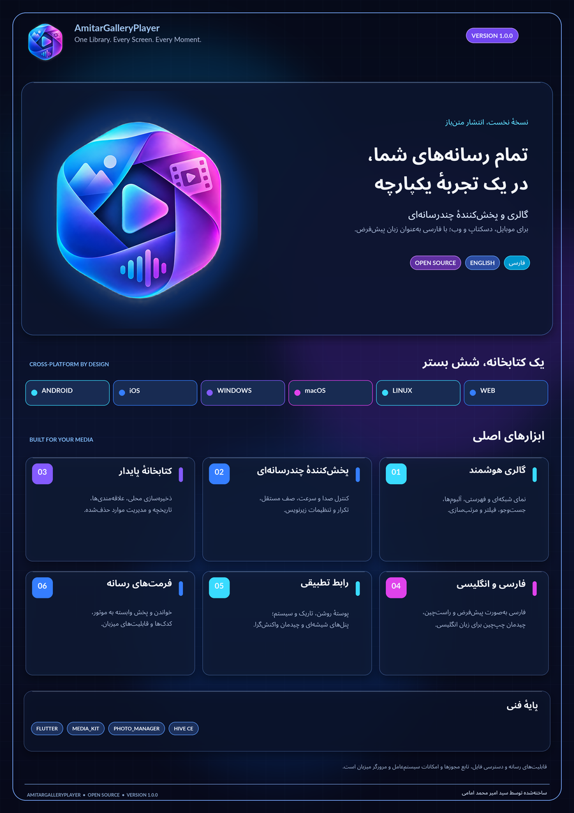

# AmitarGalleryPlayer 1.0.0

**یک کتابخانه؛ هر صفحه؛ هر لحظه.**

AmitarGalleryPlayer یک گالری و پخش‌کنندهٔ رسانهٔ Flutter با رابط فارسی پیش‌فرض و راست‌به‌چپ و ترجمهٔ انگلیسی است. مجوز کد خود برنامه MIT است؛ مجوز بسته‌ها و کتابخانه‌های codec شخص ثالث جداگانه باقی می‌ماند.




## مشخصات

- نسخه: `1.0.0+1`
- فایل اصلی: `lib/AmitarGalleryPlayer.dart`
- سازنده: سید امیر محمد امامی
- زبان پیش‌فرض: فارسی (`fa_IR`)
- زبان دوم: انگلیسی (`en_US`)
- مجوز کد برنامه: MIT
- نسخهٔ پایهٔ Flutter در CI: `3.47.9` پایدار

## قابلیت‌های موجود در کد برنامه

- گالری رسانه با دسته‌بندی تصویر، ویدیو، صوت و موارد ناشناخته، جست‌وجو و مرتب‌سازی.
- آلبوم‌ها، علاقه‌مندی‌ها، صف پخش و سطل زباله.
- اسکن کتابخانهٔ دستگاه در Android، iOS و macOS پس از مجوز کاربر.
- اسکن پوشهٔ انتخاب‌شده توسط کاربر در Windows، Linux و macOS؛ اسکن بازگشتی بدون دنبال‌کردن symlink و با سقف ایمنی ۲۰٬۰۰۰ فایل در هر اجرا.
- پخش صوت و ویدیو با یک موتور `media_kit`.
- پیش‌نمایش تصویر، بزرگ‌نمایی و تولید thumbnail با بودجهٔ حافظهٔ محدود برای هر عملیات واردسازی/اسکن.
- خواندن و ویرایش metadata در قالب‌ها و پلتفرم‌های پشتیبانی‌شده.
- ذخیرهٔ محلی کتابخانه و تنظیمات؛ بازیابی metadata خراب با مقدارهای پیش‌فرض امن و پاک‌سازی فایل‌های stageشده در واردسازی ناموفق.
- فارسی و RTL به‌صورت پیش‌فرض، انگلیسی و LTR، تم روشن/تاریک/سیستمی، ناوبری تطبیقی و پنل‌های شیشه‌ای متحرک.
- آیکون‌های اختصاصی Android، iOS، macOS، Windows، Linux و Web با حفظ شفافیت منبع؛ آیکون پنجرهٔ GTK در Linux، آیکون‌های منوی DEB در اندازه‌های ۲۵۶/۵۱۲، لایه‌های Android Adaptive، فایل ICO چنداندازه و اعتبارسنجی خودکار ارجاع‌های همهٔ پلتفرم‌ها؛ به‌همراه پوستر فارسی A3 با وضوح ۳۰۰ DPI.

## بازتولید آیکون و پوستر

تصویر اصلی ارسالی شما در `assets/brand/AmitarGalleryPlayer_UserProvided.png` بدون تغییر بایت‌به‌بایت نگهداری می‌شود. بخش‌های سرمه‌ای داخل طرح، پیکسل‌های مات خود تصویر هستند و حذف نمی‌شوند؛ فقط نواحی شفاف بیرونی و لبه‌های نیمه‌شفاف، شفاف باقی می‌مانند. فایل منبع RGBA است؛ تمام خروجی‌های رنگی آیکون کانال شفافیت را حفظ می‌کنند و هیچ برش، تغییر رنگ، محوکردن، تخت‌سازی یا پس‌زمینهٔ جدیدی به آن‌ها اضافه نمی‌شود. لوگوی داخل خود برنامه نیز از همان PNG اصلی استفاده می‌کند. لایهٔ پس‌زمینهٔ Android Adaptive کاملاً شفاف است. نسخهٔ Monochrome فقط مشتق اختیاری برای آیکون تم‌پذیر Android است.

**استثنای iOS:** آیکون اصلی مورد استفاده در App Store باید کاملاً مات و بدون کانال Alpha باشد. به همین دلیل فقط برای آیکون عادی App Store یک فایل جداگانه با زمینهٔ یک‌دست سرمه‌ای تولید می‌شود. تصویر شفاف اصلی برای آیکون Dark شفاف در iOS 18+ و برای Android، Web، Windows، Linux و macOS حفظ می‌شود. فایل شفاف اصلی هرگز تخت یا بازنویسی نمی‌شود. جزئیات در [سیاست آیکون](ICON_POLICY.md) آمده است.

برای بازتولید فایل‌های برندینگ (ابزار اختیاری، خارج از runtime برنامه):

```bash
python3 -m pip install -r tool/requirements-branding.txt
python3 tool/generate_brand_assets.py
```

این ابزار به Pillow دارای پشتیبانی RAQM برای شکل‌دهی فارسی، NumPy و ReportLab نیاز دارد.

## مرزهای واقعی پلتفرم

| پلتفرم | خروجی تعریف‌شده در CI | محدودیت مهم |
|---|---|---|
| Android | APKهای معماری‌محور و AAB | امضای انتشار باید توسط ناشر تنظیم شود؛ AAB APK نصب مستقیم نیست. |
| Windows | ZIP قابل‌حمل و Setup EXE | بدون امضای Authenticode. |
| Linux | TAR.GZ و DEB | به GTK و runtime سازگار `libmpv` نیاز دارد. |
| macOS | APP ZIP و DMG | بدون امضای Developer ID و notarization پیش‌فرض. |
| iOS | آرشیو APP بدون امضا | IPA قابل نصب نیست؛ برای IPA به گواهی و provisioning معتبر Apple نیاز است. |
| Web | ZIP سایت استاتیک | دسترسی فایل و codec تابع مرورگر است. |

پشتیبانی از همهٔ فرمت‌های فعلی و آینده در تمام سیستم‌عامل‌ها و مرورگرها قابل تضمین نیست. در native از قابلیت‌های `media_kit`/libmpv و در Web از decoder مرورگر استفاده می‌شود. جزئیات در [راهنمای فرمت‌ها](SUPPORTED_FORMATS.md) آمده است.

## شروع سریع

پیش‌نیاز: Flutter نسخهٔ پایدار `3.47.9` یا بالاتر و SDK ابزار بومی پلتفرم مقصد. در Windows، پیش از ساخت Android مطمئن شوید `flutter doctor -v`، JDK `17.x` را گزارش می‌کند. برای تنظیم خودکار (و نصب JDK در صورت نیاز) از ریشهٔ پروژه اجرا کنید: `tool\setup_android_jdk_windows.bat -InstallIfMissing`.

```bash
python3 tool/bootstrap_platforms.py
flutter pub get
python3 tool/check_release_version.py
python3 -m unittest discover -s tool -p 'test_*.py' -v
flutter analyze
flutter test
dart run flutter_launcher_icons
python3 tool/verify_platform_icons.py
```

ساخت باید روی میزبان متناظر انجام شود:

```bash
python3 tool/build.py android
python3 tool/build.py web
python3 tool/build.py linux
python3 tool/build.py windows
python3 tool/build.py macos
python3 tool/build.py ios
```

راهنمای کامل فارسی: [BUILD_GUIDE_FA.md](BUILD_GUIDE_FA.md)

### دریافت امن Gradle Wrapper در CI

فایل باینری `android/gradle/wrapper/gradle-wrapper.jar` عمداً در سورس نگهداری نمی‌شود. ابزار `tool/bootstrap_platforms.py` نسخهٔ مورد انتظار Gradle 8.14.6 را از commit ثابت مخزن رسمی Gradle دریافت می‌کند، SHA-256 را با مقدار منتشرشده توسط Gradle تطبیق می‌دهد و فقط پس از تأیید ساختار JAR آن را نصب می‌کند. در GitHub Actions، Job کیفیت فایل تأییدشده را به‌صورت artifact کوتاه‌عمر به Jobهای Linux، Windows و macOS می‌فرستد؛ هر Job پیش از ساخت دوباره آن را اعتبارسنجی می‌کند. Workflow اصلی پروژه فقط در `.github/workflows/build.yml` قرار دارد؛ برای جلوگیری از اجرای تکراری، Workflow دوم با نام مشابه نسازید.

## کنترل صحت فایل‌های منبع

پس از تغییر فایل‌های پروژه، manifest را بازتولید و از ریشهٔ مخزن بررسی کنید:

```bash
python3 tool/update_source_checksums.py
sha256sum --check SHA256SUMS.txt
```

خود فایل manifest و پوشه‌های موقت/cache در محاسبهٔ آن وارد نمی‌شوند.

## انتشار در GitHub

Workflow پروژه، آزمون‌ها را اجرا می‌کند، وابستگی‌ها را resolve می‌کند، lockfile همان اجرا را بین runnerها منتقل می‌کند، سپس خروجی‌های native را روی Ubuntu، Windows و macOS می‌سازد. با push کردن tag زیر، GitHub Release خودکار ایجاد و فایل‌های ساخته‌شده پیوست می‌شوند:

```bash
git tag -a v1.0.0 -m "AmitarGalleryPlayer 1.0.0"
git push origin v1.0.0
```

GitHub Actions باید فعال باشد و `GITHUB_TOKEN` مجوز `contents: write` داشته باشد. workflow امضای ناشر برای Android/Windows/macOS یا provisioning مربوط به Apple ایجاد نمی‌کند. secretهای امضا را فقط در GitHub Secrets/Environments نگه دارید و هرگز commit نکنید.

## اسناد و منابع

- [راهنمای ساخت و انتشار فارسی](BUILD_GUIDE_FA.md)
- [ماتریس پشتیبانی فرمت و پلتفرم](SUPPORTED_FORMATS.md)
- [نقش وابستگی‌ها](DEPENDENCIES.md)
- [گزارش اعتبارسنجی](VALIDATION_REPORT.md)
- [پوستر A3 فارسی PDF](presentation/AmitarGalleryPlayer_Poster_FA_A3.pdf)
- [پوستر A3 فارسی PNG با ۳۰۰ DPI](presentation/AmitarGalleryPlayer_Poster_FA_A3_300dpi.png)
- [آیکون شفاف ۱۰۲۴ پیکسل](presentation/AmitarGalleryPlayer_Icon_1024.png)
- [سیاست شفافیت و محدودیت iOS](ICON_POLICY.md)
- [آیکون Windows با چند اندازه](assets/icons/app-icon.ico)
- [چک‌لیست انتشار](RELEASE_CHECKLIST.md)
- [تغییرات نسخه](CHANGELOG.md)
- [مجوز MIT](LICENSE)

کد منبع یک خروجی release candidate است. فقط پس از موفقیت jobهای native و آزمون روی دستگاه/مرورگر می‌توان باینری هر پلتفرم را تأییدشده تلقی کرد.

### زنجیرهٔ ساخت Android

نسخه‌های ثابت پروژه عبارت‌اند از JDK `17`، AGP `8.13.2`، Gradle Wrapper `8.14.6` و Kotlin Gradle Plugin `2.4.21`. فایل `android/settings.gradle.kts` شناسهٔ `com.android.application` را مستقیماً به ماژول رسمی `com.android.tools.build:gradle:<version>` نگاشت می‌کند تا حل افزونه به POM واسط plugin-marker وابسته نباشد؛ مخزن رسمی `google()` همچنان فعال است. در ویندوز، `tool\check_android_maven_windows.bat` دسترسی به POM اصلی AGP و POM واسط را آزمایش می‌کند. اگر POM اصلی قابل دریافت نباشد، باید DNS/Proxy/Firewall/TLS یا دسترسی به Google Maven اصلاح شود؛ در شبکه‌ای که mirror مورداعتماد دارد می‌توان متغیر `AMITAR_GOOGLE_MAVEN_MIRROR` را به آدرس HTTPS آن تنظیم کرد. تغییر نسخهٔ Java یا Gradle مشکل قطع دسترسی مخزن را حل نمی‌کند. پس از اصلاح دسترسی، یک‌بار از پوشهٔ `android` دستور `gradlew.bat --stop` و سپس `gradlew.bat --refresh-dependencies :app:assembleDebug` را اجرا کنید. KGP 2.4.21 طبق ماتریس رسمی با AGP 8.13.2 و Gradle 8.14.6 سازگار است. AGP 9.5 با KGP 2.4.21 در بازهٔ سازگاری کامل نیست و مهاجرت AGP 9 در Flutter به بررسی سازگاری Kotlin داخلی و تمام افزونه‌ها وابسته است؛ به همین دلیل در این نسخه از زنجیرهٔ سازگار AGP 8.13 استفاده می‌شود. Flutter پایدار `3.47.9` نسخهٔ Dart و تنظیمات SDK/NDK اندروید را مدیریت می‌کند. فقط از Gradle Wrapper خود پروژه استفاده کنید. فایل `android/local.properties` محلی و تولیدشده توسط Flutter است و در مخزن نگهداری نمی‌شود.

برای امضای ناشر، `android/key.properties.example` را به `android/key.properties` کپی و با keystore خصوصی خود تکمیل کنید. بدون آن خروجی Release با گواهی debug ساخته می‌شود و برای انتشار فروشگاهی production-ready نیست. هیچ کلید یا keystore واقعی را commit نکنید. برای امضای خودکار در GitHub Actions، هر چهار Secret مخزن یا Environment را با نام‌های `AMITAR_ANDROID_KEYSTORE_BASE64` (فایل JKS/PKCS12 به‌شکل Base64)، `AMITAR_ANDROID_STORE_PASSWORD`، `AMITAR_ANDROID_KEY_PASSWORD` و `AMITAR_ANDROID_KEY_ALIAS` تعریف کنید. فایل keystore فقط در پوشهٔ موقت runner رمزگشایی می‌شود؛ تعریف ناقص Secretها build را متوقف می‌کند. اگر هیچ‌کدام تنظیم نشوند، خروجی CI با کلید موقت debug و صرفاً برای QA ساخته می‌شود.

