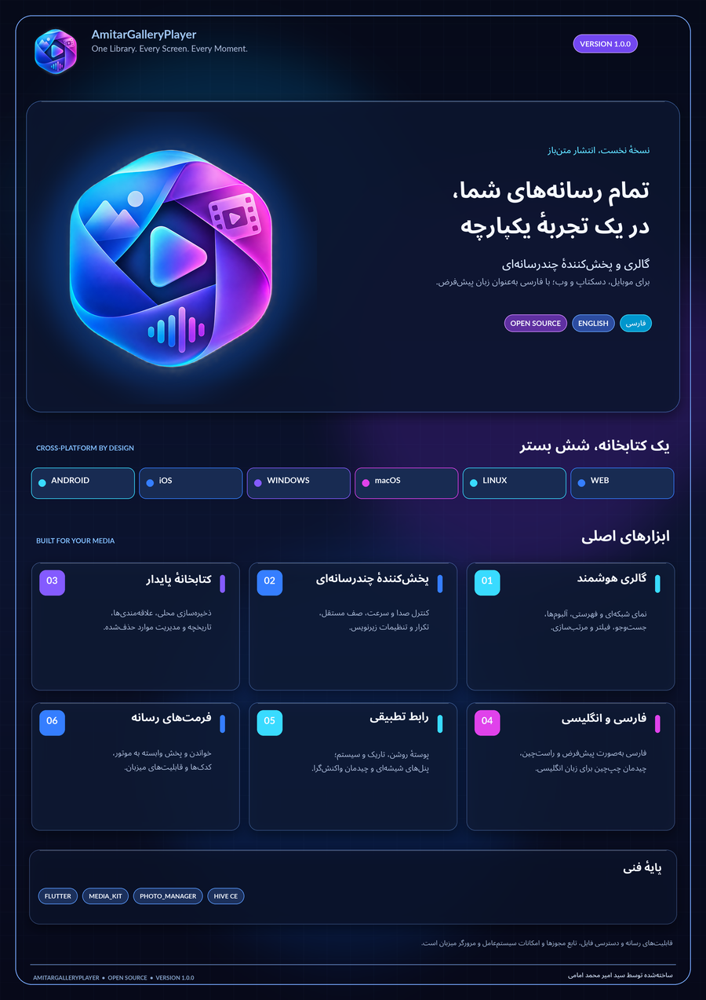

# AmitarGalleryPlayer 1.0.0

**One Library. Every Screen. Every Moment.**

A Flutter media gallery and player with a Persian-first, right-to-left interface and English localization. The repository is released under the MIT License for the application source. Third-party packages and native codec libraries retain their own licenses.

**فارسی:** [خواندن README فارسی](README.fa.md) · [راهنمای ساخت فارسی](BUILD_GUIDE_FA.md)




## Release identity

- Application: `AmitarGalleryPlayer`
- Version: `1.0.0+1`
- Main Dart entrypoint: `lib/AmitarGalleryPlayer.dart`
- Creator: **Seyed Amir Mohammad Emami** (`سید امیر محمد امامی`)
- Source license: MIT
- Default locale: Persian (`fa_IR`, RTL)
- Additional locale: English (`en_US`)

## Main capabilities

- Gallery with media classification, search, sorting, favorites, albums and trash.
- Native device-library scanning on Android, iOS and macOS where the user grants access.
- User-selected folder scanning on Windows, Linux and macOS; file and folder selection elsewhere follows platform/browser APIs.
- Video/audio playback through one `media_kit` engine, with a persistent playback queue and player controls.
- Image preview, zoom, thumbnail generation and supported raster/SVG decoding.
- Metadata reading/editing where the format and platform permit it.
- Persistent library records and settings.
- Persian-first RTL and English LTR, light/dark/system themes, adaptive navigation, keyboard-aware desktop interaction and animated glass panels.
- Platform-specific Android, iOS, macOS, Windows, Linux and Web icons with source alpha preserved; GTK window branding and 256/512-pixel hicolor menu icons for Linux DEB, transparent Android adaptive layers, optional monochrome derivative, iOS store-compliant and dark-transparent assets, multi-resolution Windows ICO, and an automated cross-platform icon-reference validator. The A3 Persian presentation poster is supplied at 300 DPI. All outputs are generated from the byte-preserved user artwork in `assets/brand/AmitarGalleryPlayer_UserProvided.png`.

The application deliberately uses one playback stack. Adding another player or duplicate storage layer would increase conflicts and maintenance cost without adding a clear platform capability.

## Reproducible branding assets

The approved source artwork is kept byte-for-byte at `assets/brand/AmitarGalleryPlayer_UserProvided.png`. Its opaque navy artwork pixels remain intact; only its existing outer transparent and semi-transparent pixels remain transparent. The source is an RGBA PNG; color icon exports preserve its alpha channel and do not crop, recolor, blur, flatten or add a background. The in-app logo also uses the original PNG directly. Android's adaptive background layer is fully transparent. The Android monochrome icon is a separate optional system-themed derivative.

**iOS exception:** Apple's App Store primary icon must be opaque. The generator therefore creates a separate `ios-app-store-1024.png` using a solid navy fill only for the ordinary iOS App Store icon. The original transparent artwork is still used for the iOS 18+ dark transparent icon and remains the primary color icon for Android, Web, Windows, Linux and macOS. No transparent source file is overwritten or flattened. See [ICON_POLICY.md](ICON_POLICY.md).

To regenerate them (optional artwork tooling, not a Flutter runtime dependency):

```bash
python3 -m pip install -r tool/requirements-branding.txt
python3 tool/generate_brand_assets.py
```

The generator requires Pillow with RAQM support for Persian shaping, NumPy and ReportLab.

## Platform reality

| Target | Native build output in CI | Important boundary |
|---|---|---|
| Android | Split APKs + AAB | AAB is for store upload; publisher signing is required for production distribution. |
| Windows | Portable ZIP + Setup EXE | Setup is not Authenticode-signed by this repository. |
| Linux | TAR.GZ + DEB | Runtime `libmpv` and GTK dependencies must be present or installed from the package metadata. |
| macOS | APP ZIP + DMG | Unsigned and not notarized by default. |
| iOS | Unsigned APP validation archive | Not an installable IPA. An IPA requires an Apple signing identity, provisioning and export configuration. |
| Web | Static Web ZIP | Browser file access and supported codecs are controlled by the browser. |

No player can promise every existing or future media format on every processor, operating system and browser. Native playback uses the capabilities distributed with `media_kit`/libmpv and the target OS. Web playback uses browser media decoders and is materially more restricted. See [Supported formats and platform boundaries](SUPPORTED_FORMATS.md).

## Quick start

Requirements: Flutter **3.47.9 or newer stable**, the target platform SDK/toolchain, and the relevant native dependencies. Flutter/Dart and native SDK versions must be supported by the selected stable Flutter release.

```bash
python3 tool/bootstrap_platforms.py
flutter pub get
python3 tool/check_release_version.py
python3 -m unittest discover -s tool -p 'test_*.py' -v
flutter analyze
flutter test
dart run flutter_launcher_icons
python3 tool/verify_platform_icons.py
```

All build commands pass the renamed entrypoint explicitly:

```bash
python3 tool/build.py android
python3 tool/build.py web
python3 tool/build.py linux
python3 tool/build.py windows
python3 tool/build.py macos
python3 tool/build.py ios
```

`python3 tool/build.py all` builds Android + Web and the desktop/mobile Apple or desktop host targets supported by the current build host. Windows, macOS and Linux desktop targets must be compiled on their corresponding host OS. Outputs are written to `dist/`; the command emits a build manifest and SHA-256 checksums.

See [Persian build and release guide](BUILD_GUIDE_FA.md) for platform prerequisites, signing boundaries and GitHub release instructions.

## GitHub Actions and releases

The workflow at `.github/workflows/build.yml` has separate native build jobs:

- Ubuntu: Android, Web and Linux.
- Windows: Windows portable package and Setup EXE.
- macOS: macOS APP/DMG and an unsigned iOS validation archive.
- Tag release: verifies runner checksums and attaches each platform artifact to a GitHub Release.

To publish the first release after pushing the repository to GitHub:

```bash
git tag -a v1.0.0 -m "AmitarGalleryPlayer 1.0.0"
git push origin v1.0.0
```

The release workflow requires GitHub Actions to be enabled and `GITHUB_TOKEN` to have repository contents write permission. It does not create Apple, Android or Windows publisher signatures. Configure those separately with publisher-owned credentials stored as GitHub Actions secrets/environments; never commit certificates, keys, provisioning profiles or passwords.

The quality job resolves the Flutter dependency lock and transfers that exact `pubspec.lock` to all native build jobs in the same workflow run. A lockfile is generated by `flutter pub get`; this source archive does not fabricate a lockfile without running the Pub resolver.

## Repository map

```text
lib/AmitarGalleryPlayer.dart       Main single-file Flutter application
assets/                          App branding and platform icon sources
presentation/                    Persian A3 poster and icon artwork
tool/bootstrap_platforms.py      Native host generation and permissions
tool/build.py                    Host-aware build and installer packaging
tool/finalize_artifacts.py       Build-manifest and checksum verification
tool/check_release_version.py    Version/tag identity check
tool/test_*.py                   Python tests for build tooling
test/                            Flutter model regression tests
.github/workflows/build.yml      CI, native builds and tagged GitHub releases
```

## Language and visual design

Persian is the default locale and uses RTL directionality; English uses LTR. The UI includes system/light/dark themes, adaptive navigation, animated ambient gradients and translucent/blurred panels. System font fallback is used; no proprietary font files are bundled.

## Security and privacy

Media access is user-mediated. The app does not request Android `MANAGE_EXTERNAL_STORAGE`; mobile media access uses the platform media-library APIs, while desktop folder traversal starts only after a user selects a folder. Browser access is mediated by browser picker/download permissions. Review [SECURITY.md](SECURITY.md) before reporting a security issue.

## Project materials

- [Persian A3 poster (PDF)](presentation/AmitarGalleryPlayer_Poster_FA_A3.pdf)
- [Persian A3 poster (PNG, 300 DPI)](presentation/AmitarGalleryPlayer_Poster_FA_A3_300dpi.png)
- [Transparent app icon (1024 px)](presentation/AmitarGalleryPlayer_Icon_1024.png)
- [Icon alpha/platform policy](ICON_POLICY.md)
- [Windows multi-resolution ICO](assets/icons/app-icon.ico)
- [Release checklist](RELEASE_CHECKLIST.md)
- [Dependency roles](DEPENDENCIES.md)
- [Supported media formats](SUPPORTED_FORMATS.md)
- [Changelog](CHANGELOG.md)
- [MIT License](LICENSE)

## Disclaimer

This is a source release with automated build definitions. A platform binary is considered validated only after its corresponding native CI build and target-device/runtime tests have succeeded. The source archive itself is not proof that every target binary has already been compiled or tested.

### Android build toolchain

The Gradle 8.14.6 Wrapper JAR is fetched from the immutable Gradle source commit `c27417f` and verified against the SHA-256 published by Gradle before use. The quality job uploads that verified JAR as a short-lived workflow artifact, and the Linux, Windows and macOS jobs download it and verify it again before building. The repository does not trust an unverified wrapper binary. The Android host is pinned to JDK `17`, AGP `8.13.2`, Gradle Wrapper `8.14.6`, and Kotlin Gradle Plugin `2.4.21`. `android/settings.gradle.kts` maps `com.android.application` directly to `com.android.tools.build:gradle:<version>` so resolution does not depend on the Android plugin-marker POM; the canonical `google()` repository remains enabled. On Windows, `tool\check_android_maven_windows.bat` tests reachability of the actual AGP implementation POM and the optional marker POM. If the implementation POM cannot be reached, fix DNS/proxy/firewall/TLS access or set `AMITAR_GOOGLE_MAVEN_MIRROR` to an explicitly trusted HTTPS Google Maven mirror; do not change JDK/Gradle versions to mask a repository outage. After repository access is restored, run `cd android && gradlew.bat --stop && gradlew.bat --refresh-dependencies :app:assembleDebug` once before `flutter run`. On Windows, run `tool\setup_android_jdk_windows.bat -InstallIfMissing` before an Android build; it selects JDK 17 through `flutter config --jdk-dir` and verifies the selection with `flutter doctor -v`. Gradle 8.14.6 cannot run on Java 25; do not upgrade the wrapper to Gradle 9.x without validating the complete Flutter/AGP/Kotlin plugin matrix. The Kotlin compatibility matrix lists KGP 2.4.21 as fully supporting AGP 8.5.2–9.3.1 and Gradle 7.6.3–9.7.0, so it is compatible with this AGP 8.13.2 / Gradle 8.14.6 pairing. AGP 9.5 requires Gradle 9.6 but is outside KGP 2.4.21’s fully supported AGP range (through 9.3.1); Flutter AGP 9 migration also requires verifying built-in Kotlin compatibility for every Android plugin. This release therefore keeps the AGP 8.13 toolchain with the latest compatible Gradle 8.14 patch rather than forcing an unvalidated major migration. Flutter `3.47.9` stable supplies the Dart SDK and Android SDK/NDK version declarations. Use the project Gradle Wrapper rather than a globally installed Gradle. `android/local.properties` is generated locally and is intentionally not included in source control.

Publisher signing is optional for local QA. Copy `android/key.properties.example` to `android/key.properties` and supply a private keystore to create publisher-signed Android release outputs. Without it, Android release builds use the debug certificate and are not production-store releases. Never commit the key file or keystore. GitHub Actions can use a publisher keystore when all four repository/environment secrets are configured: `AMITAR_ANDROID_KEYSTORE_BASE64` (base64-encoded JKS/PKCS12 file), `AMITAR_ANDROID_STORE_PASSWORD`, `AMITAR_ANDROID_KEY_PASSWORD`, and `AMITAR_ANDROID_KEY_ALIAS`. The keystore is decoded only into the runner temporary directory; a partial secret set fails the job. With no secrets, CI intentionally emits QA/debug-signed Android outputs.

